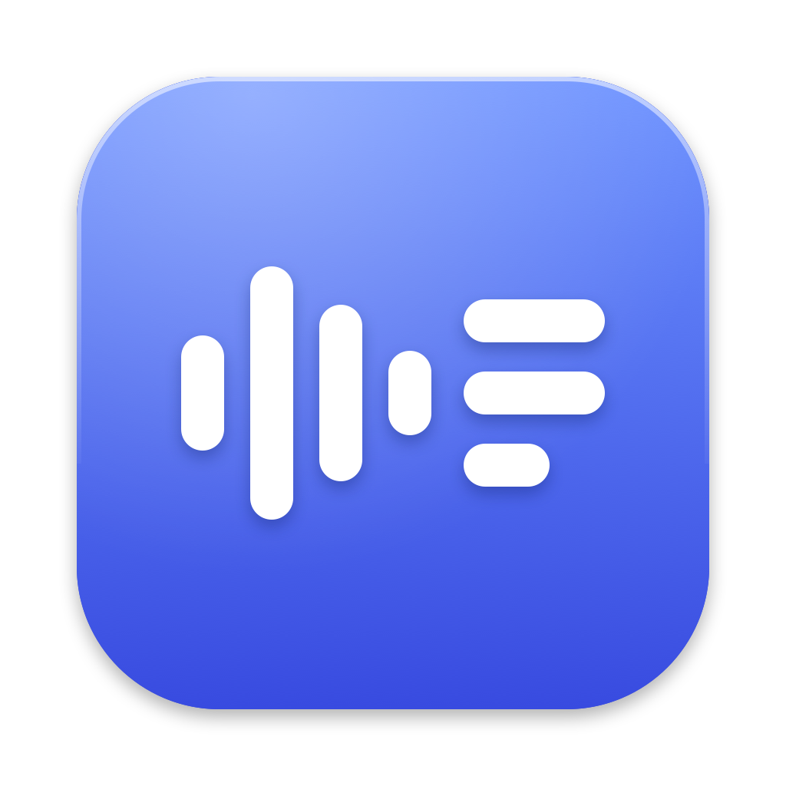

# Minutes

Minutes records your meetings and turns them into transcripts, summaries and action items, on your Mac. Nothing is uploaded, and there is no account.

## Download

**[Download Minutes for Mac](https://github.com/TurtleOfDestiny/minutes-download/releases/latest/download/Minutes.dmg)**

Open the downloaded file and drag Minutes onto the Applications folder. The app is signed and notarised by Apple, so it opens without a warning.

## What you need

- A Mac with Apple silicon (M1 or newer).
- macOS 26 or later.
- For summaries: Apple Intelligence turned on. Recording, transcripts and search work without it.

## What it does

- Records your microphone and the sound of the call from the menu bar, and can offer to record when a call starts in Teams, Zoom, FaceTime, Slack, Webex or a browser. It never starts by itself.
- Shows the transcript as you talk, then separates the other voices into speakers you can name.
- Writes an overview, key points, decisions and action items for each meeting.
- Keeps notes and screenshots with the meeting, in a library you can search.
- Does all of this on your Mac. Your library, kept audio, screenshots and backups are encrypted, and the library can be locked behind Touch ID.

## The first recording

macOS asks for permission the first time: Microphone, System Audio Recording, Calendar (to name a recording after its meeting) and Screen Recording (only if you take a screenshot). Allow the ones you want to use.

## Tell people you are recording

Only you can see that Minutes is recording. In many places the law requires that everyone in a conversation knows, or agrees, before it is recorded, and if you record for work you normally have to tell people anyway. Minutes reminds you each time and gives you a sentence to paste into the meeting chat. Telling people, and following the rules where you are, is up to you.

## Privacy and help

- [Privacy policy](https://turtleofdestiny.github.io/minutes-privacy/)
- Questions or problems: [open an issue](https://github.com/TurtleOfDestiny/minutes-download/issues)
